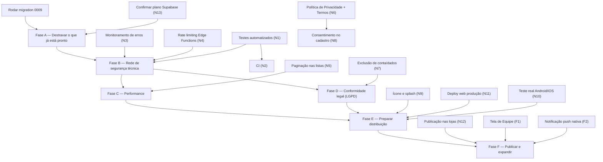

# Requisitos e Cronograma — spokfinRM

Visão consolidada de **tudo** que o projeto precisa (funcional e não-funcional), separando o que já existe do que falta, e uma ordem de execução para o que falta que respeita dependências reais (não dá pra testar em loja de app sem ícone; não dá pra lançar publicamente sem política de privacidade; não dá pra confiar em performance sem paginação testada, etc.).

Este documento não repete os critérios de aceite tela-a-tela — isso já está em [historias-de-usuario.md](historias-de-usuario.md). Aqui o foco é **inventário + prazos relativos + dependências**.

---

## 1. Requisitos Funcionais — Implementados

Catálogo completo com critérios de aceite em [historias-de-usuario.md](historias-de-usuario.md). Resumo por área:

| Área | Status |
|---|---|
| Autenticação (login, cadastro, recuperar senha) | ✅ Completo |
| Onboarding da empresa | ✅ Completo |
| Home (saldo, alertas de vencimento, gráfico de evolução, lançamentos recentes) | ✅ Completo |
| Lançamento — Manual / Anotar (IA texto) / Falar (IA voz) | ✅ Completo |
| Detalhes / Editar / Excluir lançamento | ✅ Completo |
| Nota fiscal (sinalizar + fechar ciclo) | ✅ Completo |
| Recibo em PDF (client-side, sem persistência) | ✅ Completo |
| Histórico (filtros, busca, período, exportar PDF) | ✅ Completo |
| Clientes (lista, busca, cadastro, excluir/arquivar) | ✅ Completo |
| Ficha do Cliente (débito, total pago, serviços prestados, encarregados) | ✅ Completo |
| MRR / Assinantes Mensais | ✅ Completo |
| Aba Balanço (balancete mensal) | ✅ Completo |
| Avisos in-app (vencimento + assinatura atrasada) | ✅ Completo |
| Navegação (shell, ações rápidas) | ✅ Completo |

**Pendência operacional, não de código**: migration `0009_arquivar_cliente.sql` precisa ser rodada no Supabase (adiciona `clientes.ativo`) — sem ela, excluir/arquivar cliente quebra com `column clientes.ativo does not exist`.

---

## 2. Requisitos Funcionais — Pendentes/Futuros

| # | Requisito | Por que ainda não existe |
|---|---|---|
| F1 | Tela de Equipe (convidar funcionário/contador) | Backend (`membros`, `convidar_membro`) já existe desde a Fase 2; decisão explícita de deixar fora de escopo enquanto o uso é solo (um dono por empresa) |
| F2 | Notificação push nativa (fora do app aberto) | Hoje os avisos só aparecem dentro do app (Home); push de verdade exige decisão de mecanismo (`flutter_local_notifications`, FCM/APNs) e permissões de SO |
| F3 | Cobrança da assinatura do próprio spokfinRM (Fase 3 do roadmap original) | Monetização do SaaS em si — diferente do MRR do usuário (que já cobra os *próprios* clientes) |
| F4 | DRE detalhado por categoria na aba Balanço | Decisão explícita de começar simples (receitas x despesas x líquido); detalhamento por categoria fica pra quando houver demanda |

---

## 3. Requisitos Não-Funcionais — Atendidos

| Categoria | O que já existe |
|---|---|
| Segurança de dados | RLS em todas as tabelas via `is_member`/`is_owner` (security definer functions); cada empresa só vê os próprios dados |
| Autenticação | Supabase Auth (e-mail/senha), recuperação de senha completa dentro do app |
| Segredos | `OPENAI_API_KEY` só existe no servidor (Edge Functions); nunca exposta ao cliente Flutter |
| Persistência de PDF | Recibo e relatório de período são gerados 100% client-side e compartilhados via share sheet nativo — nada fica armazenado no Supabase Storage, então não há dado sensível "esquecido" em disco |
| Qualidade de código | `flutter_lints` configurado, `flutter analyze` limpo em todo o projeto |
| Convenção de mudança | Prática de SDD (`specs/NNNN-nome/requirements.md` → `design.md` → `tasks.md`) para toda feature nova a partir da Fase 2 |

---

## 4. Requisitos Não-Funcionais — Pendentes

| # | Requisito | Categoria | Impacto se não resolvido |
|---|---|---|---|
| N1 | Testes automatizados (unit para regras críticas: `calcular_saldo`, troca pago↔pendente, RLS) | Qualidade | Só existe o `widget_test.dart` padrão do Flutter — hoje toda regressão é pega manualmente |
| N2 | CI (rodar `flutter analyze` + testes a cada push) | Qualidade | Sem N1 primeiro, não há o que rodar de útil |
| N3 | Monitoramento de erros em produção (ex: Sentry) | Observabilidade | Hoje um erro em produção só aparece se o usuário reportar |
| N4 | Rate limiting / limite de uso nas Edge Functions de IA (`parse-lancamento`, `transcrever-audio`) | Segurança/Custo | Sem isso, uso indevido ou bug em loop pode gerar custo de API descontrolado |
| N5 | Paginação nas listas (Histórico, Clientes, MRR) | Performance | Hoje carrega tudo de uma vez; funciona bem com poucos registros, degrada conforme a base cresce |
| N6 | Política de Privacidade + Termos de Uso | Legal/LGPD | Bloqueador para lançamento público — app guarda dados pessoais de clientes (nome, telefone) |
| N7 | Fluxo de exclusão de conta e dados do próprio usuário (direito ao esquecimento) | Legal/LGPD | Hoje só existe exclusão de *cliente*; não existe "excluir minha conta/empresa" |
| N8 | Consentimento explícito no cadastro (aceite de termos) | Legal/LGPD | Depende de N6 existir primeiro |
| N9 | Ícone de app e splash screen personalizados | Distribuição | Hoje usa o ícone/splash padrão do Flutter — bloqueador de fato para lojas (Apple/Google rejeitam ícone padrão) |
| N10 | Teste real em emulador/dispositivo Android e iOS | Distribuição | Todo o desenvolvimento e teste desta sessão foi via `flutter run -d chrome`/web-server; mobile nunca foi validado de fato, apesar do projeto ter os diretórios `android/`/`ios/` desde a Fase 0 |
| N11 | Deploy web de produção (hosting + domínio + HTTPS) | Distribuição | Hoje só roda em `localhost` durante desenvolvimento |
| N12 | Publicação nas lojas (Google Play / App Store) | Distribuição | Depende de conta de desenvolvedor (custo: única vez ~US$25 Google, ~US$99/ano Apple) — decisão de produto, não só técnica |
| N13 | Confirmar plano/tier do Supabase (backup automático, limites de linha/storage) | Confiabilidade | Plano gratuito tem backup e limites diferentes do pago; decisão de produto |

---

## 5. Cronograma de Execução

Ordenado por **dependência real** — cada fase assume que a anterior está pronta. Fases sem dependência cruzada entre si podem rodar em paralelo (indicado abaixo).

### Fase A — Destravar o que já está pronto
*Sem dependências técnicas; pode começar imediatamente.*
- Rodar `supabase/migrations/0009_arquivar_cliente.sql` no SQL Editor.
- Confirmar/decidir o plano Supabase (N13) — define se backup automático e limites atuais são adequados antes de crescer a base de dados.

### Fase B — Rede de segurança técnica
*Depende da Fase A só no sentido de "app já funcional"; tecnicamente pode começar em paralelo com A.*
- **N1** Testes automatizados das regras de negócio mais críticas (cálculo de saldo, troca pago↔pendente, RLS por empresa) — é a base para tudo que vem depois, já que sem isso qualquer mudança futura arrisca regressão silenciosa.
- **N2** CI rodando `flutter analyze` + os testes de N1 a cada push — só faz sentido depois de N1 existir.
- **N3** Monitoramento de erros em produção (Sentry ou similar) — independente, mas idealmente entra antes do deploy público (Fase E).
- **N4** Rate limiting nas Edge Functions de IA — independente, mas crítico antes de qualquer exposição pública (Fase E), pra não tomar um susto de fatura da OpenAI.

### Fase C — Performance
*Depende da Fase B (N1) existir para não paginar às cegas sem cobertura de teste.*
- **N5** Paginação em Histórico, Clientes e MRR.

### Fase D — Conformidade legal (LGPD)
*Pode rodar em paralelo à Fase C — não depende de código, depende de decisão de produto/jurídico.*
- **N6** Política de Privacidade + Termos de Uso (documento).
- **N8** Consentimento explícito no cadastro (depende do texto de N6 existir).
- **N7** Fluxo de exclusão de conta e dados do usuário.

### Fase E — Preparar distribuição
*Depende de C e D estarem prontas — não faz sentido publicar um app sem paginação (trava com muitos dados) ou sem política de privacidade (rejeitado/ilegal).*
- **N9** Ícone e splash screen personalizados.
- **N11** Deploy web de produção (hosting, domínio, HTTPS).
- **N10** Teste real em emulador/dispositivo Android e iOS.

### Fase F — Publicar e expandir
*Depende inteiramente da Fase E.*
- **N12** Publicação nas lojas (Google Play / App Store) — depende de N9 e N10 prontos, mais decisão de orçamento (contas de desenvolvedor).
- **F1** Tela de Equipe (convidar funcionário/contador) — tecnicamente independente, mas faz mais sentido priorizar depois que o produto está publicado e há motivo real para múltiplos usuários por empresa.
- **F2** Notificação push nativa — depende de N10 (app já validado em dispositivo real) para o teste de notificação fazer sentido.

---

## 6. Como manter este documento vivo

- Ao concluir um item, marque-o (✅) tanto aqui quanto (se for funcional) em [historias-de-usuario.md](historias-de-usuario.md).
- Qualquer item da Fase A-F que vire trabalho de verdade deve gerar uma spec própria em `specs/NNNN-nome/`, seguindo o fluxo normal de SDD.
- Se a ordem das fases mudar (ex: decisão de priorizar lojas antes de LGPD), atualize o diagrama e a justificativa de dependência — não só a lista.
